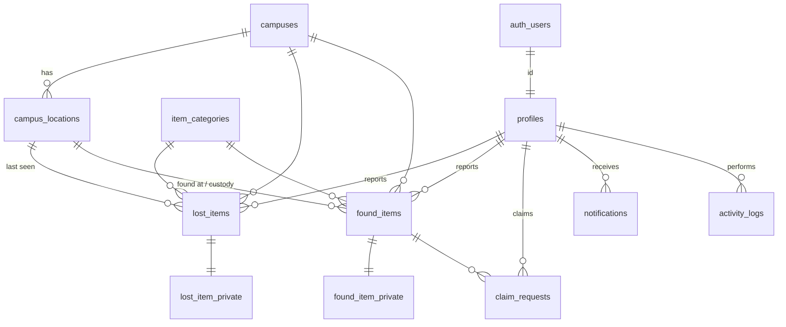

# CvSU Lost and Found System — Architecture & Implementation Plan

Status: **Phase 6 (QA) — offline part complete; live-project checklist pending.** Every planned page
is built. Lint and production build pass; the 112-check RLS test and the frontend↔database contract
check pass (`npm test`); all pages were exercised in the browser against a mocked API. No live
Supabase project has been connected yet — see [TESTING.md](TESTING.md) for the manual checklist.

---

## 1. System architecture

```
┌──────────────────────────────────────────────┐
│  Browser — React 19 + Vite SPA (JavaScript)  │
│  React Router · TanStack Query · RHF + Zod   │
│  Tailwind CSS · lucide-react · sonner · recharts
└───────────────┬──────────────────────────────┘
                │ supabase-js (anon key + user JWT only)
                ▼
┌──────────────────────────────────────────────┐
│  Supabase                                     │
│  ├─ Auth      email/password, reset, sessions │
│  ├─ PostgREST tables guarded by RLS           │
│  ├─ RPC       SECURITY DEFINER functions for  │
│  │            every privileged state change   │
│  ├─ Triggers  profile creation, ref numbers,  │
│  │            history, notifications, audit   │
│  └─ Storage   item-images (public read)       │
│               claim-evidence (private)        │
│               avatars (public read)           │
└──────────────────────────────────────────────┘
```

**Key decision — no custom server.** All authorization lives in Postgres (RLS + column
grants + `SECURITY DEFINER` RPCs that re-check the caller's role). The frontend only hides
UI it can't use; it is never the enforcement point. This avoids a second backend to deploy
and means the same rules apply whether a request comes from the app, `curl`, or the
Supabase JS console.

**Key decision — privileged writes go through RPCs, not table UPDATEs.** Approving a claim
must atomically: change the claim, change the item, reject competing claims, write status
history, write an audit log, and notify people. One Postgres function does all of it in a
transaction. Clients have no UPDATE grant on `status` columns at all.

---

## 2. Roles & permissions

Two separate concepts on `profiles`:

| Column      | Values                                   | Who can change it                 |
|-------------|------------------------------------------|-----------------------------------|
| `user_type` | `student`, `faculty`, `personnel`        | the user (at registration/profile)|
| `role`      | `user`, `admin`, `super_admin`           | **only** via `admin_set_user_role` RPC |

| Capability                                   | user | admin | super_admin |
|----------------------------------------------|:----:|:-----:|:-----------:|
| Report lost/found, claim, own reports/claims | ✓    | ✓     | ✓           |
| Edit/delete own report while `pending`       | ✓    | ✓     | ✓           |
| Moderate reports, verify found items         |      | ✓     | ✓           |
| Review / approve / release claims            |      | ✓     | ✓           |
| Manage categories, campuses, locations       |      | ✓     | ✓           |
| View users, activate/deactivate `user`s      |      | ✓     | ✓           |
| Activity logs, analytics                     |      | ✓     | ✓           |
| Promote/demote admins, change any role       |      |       | ✓           |
| Edit system settings                         |      |       | ✓           |

Rules enforced in the RPC: nobody changes their own role; only `super_admin` grants
`admin`/`super_admin`; the last remaining `super_admin` cannot be demoted.

**Bootstrapping:** the first super admin is promoted with a one-line SQL statement in the
Supabase SQL editor (documented in the README). There is no UI or signup path to it.

---

## 3. Database schema

### 3.1 Enums

```
user_type        : student | faculty | personnel
app_role         : user | admin | super_admin
lost_status      : pending | approved | rejected | resolved | archived
found_status     : pending_verification | verified | claimed | released | rejected | archived
claim_status     : pending | under_review | approved | rejected | released | cancelled
notification_type: report_approved | report_rejected | claim_submitted | claim_approved |
                   claim_rejected | item_released | match_suggestion | system
```

`cancelled` on claims is an **addition** (the claimant may withdraw a pending claim).

### 3.2 Tables

| Table | Purpose | Notable columns / constraints |
|---|---|---|
| `profiles` | 1:1 with `auth.users` | `full_name`, `institutional_email` (unique), `student_employee_id` (unique), `department`, `user_type`, `role` default `user`, `avatar_url`, `is_active`, timestamps |
| `item_categories` | Electronics, IDs, … | `name` unique, `slug` unique, `icon`, `is_active`, `sort_order` |
| `campuses` | CvSU campuses/branches | `name` unique, `code` unique, `is_active` |
| `campus_locations` | Places within a campus | `campus_id` FK, `name`, unique(`campus_id`,`name`), `is_active`, `is_custody_point` (e.g. OSAS office, guard house) |
| `lost_items` | Public-safe lost report fields | `reference_no` unique (`LST-2026-000001`), `reporter_id`, `item_name`, `category_id`, `description`, `date_lost` (≤ today), `time_lost`, `campus_id`, `location_id`, `location_details`, `image_path`, `status`, `resolved_at`, timestamps. Review notes live in `item_status_history` (owner + admin only), not on the public row |
| `lost_item_private` | 1:1 sensitive fields | `lost_item_id` PK/FK, `identifying_details`, `contact_name`, `contact_phone`, `contact_email` |
| `found_items` | Public-safe found report fields | `reference_no` (`FND-…`), `reporter_id`, `item_name`, `category_id`, `description` (generic), `date_found`, `time_found`, `campus_id`, `location_id`, `location_details`, `image_path`, `custody_location_id`, `status`, `verified_by`, `verified_at`, `verification_questions text[]`, timestamps |
| `found_item_private` | 1:1 sensitive fields | `found_item_id` PK/FK, `identifying_details` (serial no., contents, marks), `additional_info`, `custody_notes` |
| `claim_requests` | Ownership claims on found items | `reference_no` (`CLM-…`), `found_item_id`, `claimant_id`, `ownership_description`, `verification_answers jsonb`, `evidence_path`, `status`, `reviewed_by`, `reviewed_at`, `review_notes`, `released_at`, `released_by` (admin), `released_to_name`, `release_notes`, timestamps. **Partial unique index:** one active claim per (item, claimant) |
| `notifications` | In-app inbox | `user_id`, `type`, `title`, `body`, `link`, `read_at`, `created_at` |
| `activity_logs` | Append-only audit trail | `actor_id`, `action`, `entity_type`, `entity_id`, `details jsonb`, `created_at` |
| `item_status_history` | Status timeline per item/claim | `entity_type` (`lost_item`/`found_item`/`claim`), `entity_id`, `from_status`, `to_status`, `changed_by`, `note`, `created_at` |
| `system_settings` | Key/value config | `key` PK, `value jsonb`, `description`, `updated_by`, `updated_at` (e.g. `allowed_email_domains`, `max_upload_mb`, `require_lost_approval`) |

**Why split `*_private` tables?** RLS is row-level, not column-level. A public visitor must
see a verified found item's name/photo/location, but must **not** see the serial number or
contents that a fraudulent claimant would need. Putting those fields in a separate table
with owner/admin-only RLS is the simplest leak-proof design (no definer views to get wrong).

### 3.3 Relationships



### 3.4 Indexes

`status` + `created_at desc` on both item tables (listing default sort), `category_id`,
`campus_id`, `reporter_id`, `date_lost`/`date_found`, a `pg_trgm` GIN index on `item_name`
for `ilike` search, `claim_requests(found_item_id)`, `(claimant_id)`, `(status)`,
`notifications(user_id, read_at)`, `activity_logs(created_at desc)`,
`item_status_history(entity_type, entity_id)`.

### 3.5 Triggers & functions

| Name | Kind | Does |
|---|---|---|
| `handle_new_user` | trigger on `auth.users` insert | Creates `profiles` row from signup metadata; **always** `role='user'`; rejects emails outside `allowed_email_domains` |
| `set_updated_at` | trigger | Maintains `updated_at` |
| `assign_reference_no` | trigger | `LST-/FND-/CLM-YYYY-NNNNNN` from sequences |
| `log_status_change` | trigger | Writes `item_status_history` on every status change |
| `on_claim_created` | trigger | Notifies admins (and the finder, without claimant details) |
| `is_admin()`, `is_super_admin()`, `is_active_user()` | `STABLE SECURITY DEFINER` | Used inside RLS policies (avoids recursive RLS on `profiles`) |
| `admin_review_lost_item(id, decision, notes)` | RPC | approve / reject / archive / resolve + notify + audit |
| `admin_review_found_item(id, decision, notes, questions[], custody_location_id)` | RPC | verify / reject / archive + notify + audit |
| `admin_update_claim(id, status, notes)` | RPC | under_review / approved / rejected; approving marks item `claimed` and rejects competing claims |
| `admin_release_claim(id, released_to_name, notes)` | RPC | records release, item → `released`, matching lost report → `resolved`, notify |
| `cancel_my_claim(id)` | RPC | claimant withdraws own pending claim |
| `admin_set_user_role(user_id, role)` / `admin_set_user_active(user_id, bool)` | RPC | rules in §2 |
| `get_public_stats()` | RPC (anon) | counts for landing page |
| `get_user_dashboard()` | RPC | my counts + global counts |
| `get_admin_analytics(from, to)` | RPC (admin) | totals, by category, by campus, monthly trend, return rate, avg days-to-return |

Every RPC sets `search_path = ''` and fully qualifies names (Supabase linter requirement).

---

## 4. Row Level Security summary

RLS is **enabled on every table** in `public`.

| Table | SELECT | INSERT | UPDATE | DELETE |
|---|---|---|---|---|
| `profiles` | self, admin | — (trigger only) | self, **column grant excludes `role`, `is_active`, `institutional_email`** | — |
| categories / campuses / locations | everyone (active), admin (all) | admin | admin | admin |
| `lost_items` | public if `approved`; owner; admin | authenticated active user, `reporter_id = auth.uid()`, status forced `pending` | owner while `pending` (no `status` grant); admin via RPC | owner while `pending`; admin |
| `found_items` | public if `verified`/`claimed`; owner; admin | same pattern, status forced `pending_verification` | owner while `pending_verification` | owner while pending; admin |
| `*_private` | owner of parent item, admin | owner of parent item | owner while parent pending; admin | cascade |
| `claim_requests` | claimant, admin (**not** the finder, **not** public) | claimant = self, item `verified`, not own found item, status `pending` | none directly — RPCs only | none |
| `notifications` | own | none (definer functions) | own, **`read_at` column only** | own |
| `activity_logs` | admin | none (definer functions) | none | none |
| `item_status_history` | admin; owners of the entity | none | none | none |
| `system_settings` | public keys readable; admin all | super_admin | super_admin | super_admin |

### Storage

| Bucket | Public read | Upload rule | Limits |
|---|---|---|---|
| `item-images` | yes (paths are random UUIDs) | authenticated, path must start with `{auth.uid()}/` | 5 MB, `image/jpeg,png,webp` (bucket-level `file_size_limit` + `allowed_mime_types`) |
| `claim-evidence` | **no** — signed URLs (5 min) | claimant into own folder | 10 MB, images + `application/pdf` |
| `avatars` | yes | own folder only | 2 MB, images |

Read on `claim-evidence`: object owner or admin. Delete on own folder only.

---

## 5. Authentication design

- Supabase Auth email + password. Signup passes `full_name`, `student_employee_id`,
  `department`, `user_type` as `options.data`; the trigger copies them to `profiles` and
  ignores any `role` field a malicious client sends.
- Email domain restricted to CvSU (assumption: `@cvsu.edu.ph`) — checked by Zod on the
  client **and** by the trigger on the server (configurable in `system_settings`).
- Email confirmation: recommended ON in production; the app handles both modes.
- Forgot password → `resetPasswordForEmail(redirectTo: /reset-password)` → listens for the
  `PASSWORD_RECOVERY` event → `updateUser({ password })`.
- `AuthProvider` wraps `onAuthStateChange`, loads the profile, and exposes
  `{ session, profile, role, isAdmin, isSuperAdmin, loading }`.
- Route guards: `<RequireAuth>`, `<RequireRole roles={['admin','super_admin']}>`,
  `<GuestOnly>`. Deactivated users are signed out with a message.
- Session persistence: supabase-js default (localStorage + auto refresh).

---

## 6. Routes

| Layout | Path | Page |
|---|---|---|
| Public | `/` | Landing (live public stats, recent verified items) |
| | `/about` | About the system / how claiming works |
| | `/lost`, `/found` | Listings (grid/list, search, filters, pagination) |
| | `/lost/:id`, `/found/:id` | Item details (+ "Claim this item" on found) |
| Auth | `/login`, `/register`, `/forgot-password`, `/reset-password` | |
| User (`RequireAuth`) | `/dashboard` | Stats, my recent activity |
| | `/report/lost`, `/report/found` | Report forms (also used for edit: `/my-reports/:type/:id/edit`) |
| | `/my-reports` | Tabs: lost / found, status, edit/delete when pending |
| | `/my-claims`, `/my-claims/:id` | Claim tracker with status timeline |
| | `/found/:id/claim` | Claim form |
| | `/notifications` | Full history, mark read / all read |
| | `/profile` | Profile + avatar + change password |
| Admin (`RequireRole admin`) | `/admin` | Dashboard + charts |
| | `/admin/lost-items`, `/admin/found-items` | Moderation tables + detail drawers |
| | `/admin/claims`, `/admin/claims/:id` | Claim review incl. private answers & evidence |
| | `/admin/users` | Users, roles (super admin), activate/deactivate |
| | `/admin/categories`, `/admin/locations` | CRUD (campuses + locations) |
| | `/admin/reports` | Analytics + CSV export |
| | `/admin/activity-logs` | Filterable audit log |
| | `/admin/settings` | System settings (edit = super admin) |

---

## 7. Folder structure

```
.
├─ docs/ARCHITECTURE.md
├─ supabase/
│  ├─ migrations/
│  │  ├─ 0001_extensions_enums.sql
│  │  ├─ 0002_tables.sql
│  │  ├─ 0003_functions_triggers.sql
│  │  ├─ 0004_rls_policies.sql
│  │  ├─ 0005_rpc.sql
│  │  ├─ 0006_storage.sql
│  │  └─ 0007_reference_data.sql  # settings, categories, campuses, locations (all environments)
│  ├─ tests/
│  │  ├─ rls_test.sql          # 112 checks, runs in a rolled-back transaction
│  │  └─ local/                # offline runner: PGlite + Supabase stub
│  ├─ seed.sql                 # dev only: bootstrap the first super admin
│  └─ README.md                # how to apply migrations + auth settings
├─ src/
│  ├─ assets/
│  ├─ components/
│  │  ├─ common/   Button, Input, Select, Textarea, Badge, Card, Modal, ConfirmDialog,
│  │  │            Skeleton, EmptyState, ErrorState, Pagination, ImageUpload, StatusBadge
│  │  ├─ layout/   PublicLayout, UserLayout, AdminLayout, Navbar, Sidebar, NotificationBell
│  │  ├─ forms/    LostItemForm, FoundItemForm, ClaimForm
│  │  ├─ dashboard/StatCard, charts
│  │  ├─ items/    ItemCard, ItemListRow, ItemFilters, StatusTimeline
│  │  └─ admin/    DataTable, ReviewDrawer, UserRoleMenu
│  ├─ contexts/AuthContext.jsx
│  ├─ hooks/       useAuth, useItems, useClaims, useNotifications, useLookups …
│  ├─ lib/         supabase.js, queryClient.js, constants.js
│  ├─ services/    auth, items, claims, notifications, storage, admin, lookups (all Supabase calls)
│  ├─ schemas/     Zod schemas (auth, lostItem, foundItem, claim, profile, admin)
│  ├─ utils/       format, storage paths, file validation
│  ├─ pages/{public,auth,user,admin}/
│  ├─ routes/      AppRoutes.jsx, guards
│  ├─ App.jsx
│  └─ main.jsx
├─ .env.example                # VITE_SUPABASE_URL, VITE_SUPABASE_ANON_KEY only
└─ README.md                   # install, migrate, bootstrap super admin, deploy, test checklist
```

Layering: **pages** compose components and call **hooks** (TanStack Query) → **services**
(the only files that import `supabase`). Components never talk to Supabase directly.

---

## 8. Security considerations

1. **Service role key never touches the frontend.** Only `VITE_SUPABASE_URL` and the anon
   key are used; the anon key is safe *because* RLS is on everywhere.
2. **Role escalation:** `role` has no client UPDATE grant; signup metadata `role` is ignored;
   RPCs re-check `is_admin()` server-side.
3. **Fraudulent claims:** identifying details live in `found_item_private`; public descriptions
   are reviewed by admins at verification; claim answers visible only to claimant + admins;
   the finder is notified a claim exists but cannot see who or what was answered; claims are
   **never** auto-approved.
4. **Contact info** (`lost_item_private`) is owner/admin only.
5. **Uploads:** MIME + size checked on the client (UX) and by bucket config (enforcement);
   folder-per-user path policies; evidence bucket private with short-lived signed URLs.
6. **Audit:** every admin RPC writes `activity_logs`; clients cannot insert/alter logs.
7. **State machine:** DB `CHECK`s + RPC guards reject invalid transitions (e.g. releasing a
   rejected claim, claiming your own found item, claiming a non-verified item).
8. **Function hardening:** `SECURITY DEFINER` functions use `set search_path = ''` and
   `revoke execute … from public` before granting to `authenticated`.
9. **Deactivated users** fail `is_active_user()` in INSERT policies even with a valid JWT.
10. **Image privacy caveat:** a found-item photo can itself reveal identifying info. The form
    warns finders; admins can replace/remove the photo before verifying.

---

## 9. Assumptions (change any of these before Phase 2)

| # | Assumption |
|---|---|
| A1 | Institutional domain is `@cvsu.edu.ph` (configurable). |
| A2 | Hosted Supabase project (free tier works); migrations run via SQL editor or `npx supabase db push`. No Supabase CLI is installed locally yet. |
| A3 | JavaScript (not TypeScript). Installed: React 19.3, Vite 8, Tailwind CSS 4.3, React Router 7, TanStack Query 5, Zod 4, @hookform/resolvers 7, supabase-js 2.119, lucide-react 1.x, sonner 2, recharts 3. `npm audit` reports a ReDoS advisory in picomatch, a dev-only build-tool dependency of Vite that is not shipped to browsers; the suggested "fix" downgrades Vite, so it is left until Vite publishes a patch. |
| A4 | Lost reports need admin approval before public listing (toggle in `system_settings`). |
| A5 | Campuses seeded with CvSU main + satellite campuses; admins can edit the list. |
| A6 | No automatic lost↔found matching in v1; `match_suggestion` notification type is reserved. |
| A7 | In-app notifications only (no email/SMS) — Supabase Realtime used for the live unread badge. |
| A8 | "Contact information" on found-item reports is not collected; custody location replaces it. |
| A9 | Admins **deactivate** accounts rather than delete them: deleting an auth user needs the service-role key, which never reaches the browser. Permanent deletion is done in the Supabase dashboard (Authentication → Users), which cascades to the profile and the user's reports. |
| A10 | Charts use the dataviz reference palette (slots 1–3, validated against the white surface); every chart has a legend and a Table view because one slot is below 3:1 contrast. Recharts loads only on admin chart pages. |

---

## 10. Roadmap & progress tracker

| Phase | Deliverables | Status |
|---|---|---|
| 1 Architecture | this document | ✅ done |
| 2 Database | 7 migrations, seed.sql, storage buckets/policies, RLS test script (112 checks) | ✅ done — applied to the live Supabase project; `rls_test.sql` passed there (2 storage-delete checks skip on real Supabase, which forbids SQL deletes on storage.objects) |
| 3 Frontend foundation | Vite app, Tailwind theme, router + guards, 3 layouts, common components, AuthContext, notification bell (realtime), **auth pages, landing, about** (pulled forward) | ✅ done — unbuilt routes show a temporary "scheduled for Phase N" notice |
| 4 Core features | dashboard, report forms + uploads, listings (grid/list, search, filters, sort, pagination), details, claims (+ private evidence), notifications page, profile (+ avatar, password), my reports (edit/delete/mark recovered), my claims (+ withdraw) | ✅ done — found-item photo is optional (recommended) so finders without a camera can still report |
| 5 Admin | dashboard (stats, charts, queues, activity), lost/found moderation (review modal, verify with questions + custody, reject with reason, resolve, archive/restore), claim review (answers vs. private details, evidence, competing claims, approve/reject/revoke, release record), users (roles for super admin, activate/deactivate, edit details), categories, campuses + locations, reports & analytics (date presets, charts with table view, CSV export), activity logs, settings | ✅ done |
| 6 QA | lint + build clean; 112-check RLS/role test (`test:db`); contract check of all 71 service functions vs. schema & grants (`test:contract`, self-tested); browser + responsive pass on mocked API; [TESTING.md](TESTING.md) manual checklist | 🟡 offline part done; live project connected — public pages, Realtime and the Notifications page confirmed (fixed a duplicate Realtime channel crash). Rest of the manual checklist pending |
| 7 Deployment | README: env vars, Supabase prod settings (email confirm, redirect URLs, SMTP), Vercel/Netlify deploy | ⬜ |

**What can be verified here vs. by you:** the build, lint and UI rendering can be checked
locally. End-to-end behavior (auth, RLS, uploads) needs a real Supabase project URL + anon
key in `.env`; until you provide one, database code is written carefully but marked
"not yet run against Supabase".
